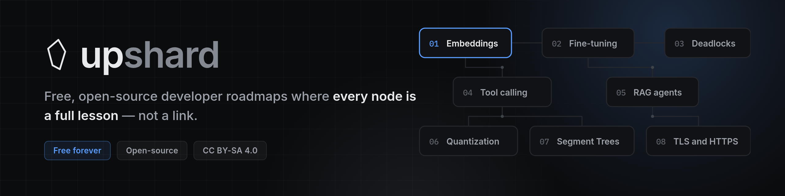
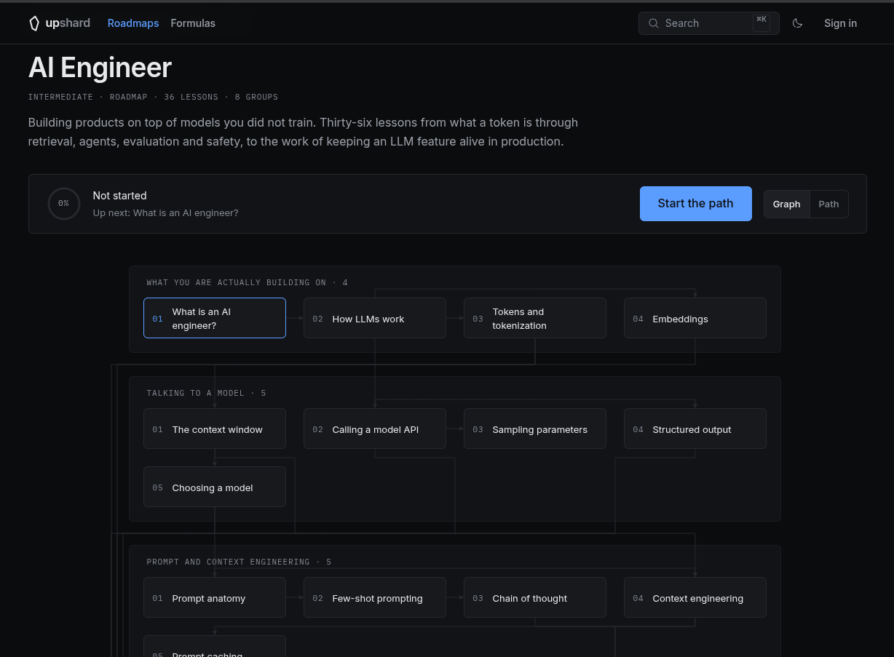

<p align="center">
  
</p>

<p align="center">
  <a href="https://www.upshard.com"><strong>upshard.com</strong></a> — free, open-source developer roadmaps where every node is a full lesson, not a link.
</p>

<p align="center">
  <a href="https://github.com/krishanu-ghosh/upshard-content/stargazers"></a>
  <a href="https://github.com/krishanu-ghosh/upshard-content/graphs/contributors"></a>
  <a href="https://github.com/krishanu-ghosh/upshard-content/issues"></a>
  <a href="https://github.com/krishanu-ghosh/upshard-content/commits/main"></a>
</p>

<p align="center">
  <a href="LICENSE"></a>
  <a href="https://www.upshard.com"></a>
  <a href="CONTRIBUTING.md"></a>
</p>

<p align="center">
  
</p>

---

# Upshard Content

The open-source lesson content and roadmap graphs behind **[Upshard](https://www.upshard.com)**.

**No SaaS. No paywall. No premium tier. No pop-up asking for your email before you can read a lesson.** The content lives here, in the open, under [CC BY-SA 4.0](LICENSE) — fork it, fix it, redistribute it, as long as you credit it and keep it open.

This repo holds the data: the roadmap graphs, the lessons rendered on each node, and the formula library referenced from them. It does not hold the Upshard application itself.

**Jump to:** [What's here](#whats-here-right-now) · [How a lesson is built](#what-a-lesson-actually-is) · [Repo layout & schema](#repo-layout) · [Contributing](#contributing) · [License](#license)

## What's here right now

| Roadmap | Level | Lessons |
|---|---|---|
| [AI Agents](roadmaps/ai-agents) | intermediate | 33 |
| [AI Data Scientist](roadmaps/ai-data-scientist) | intermediate | 29 |
| [AI Engineer](roadmaps/ai-engineer) | intermediate | 36 |
| [AI Product Builder](roadmaps/ai-product-builder) | intermediate | 30 |
| [AI Red Teaming](roadmaps/ai-red-teaming) | advanced | 24 |
| [API Design](roadmaps/api-design) | intermediate | 21 |
| [Code Review](roadmaps/code-review) | beginner | 6 |
| [Computer Science](roadmaps/computer-science) | beginner | 29 |
| [Data Structures & Algorithms](roadmaps/datastructures-and-algorithms) | beginner | 72 |
| [Inference Engineering](roadmaps/inference-engineering) | advanced | 32 |
| [Machine Learning](roadmaps/machine-learning) | intermediate | 33 |
| [MLOps](roadmaps/mlops) | intermediate | 32 |
| [Prompt Engineering](roadmaps/prompt-engineering) | beginner | 29 |
| [Software Architect](roadmaps/software-architect) | intermediate | 26 |
| [Design Principles & Patterns](roadmaps/software-design-architecture) | intermediate | 15 |
| [System Design](roadmaps/system-design) | intermediate | 60 |
| **Total — 16 roadmaps** | | **507** |

Plus an [80-entry formula library](formulas) spanning linear algebra, calculus, probability, information theory, optimization, deep learning, reinforcement learning, and inference.

More roadmaps (including the web development stack — Angular, TypeScript, JavaScript, Frontend, Backend) are live on [upshard.com](https://www.upshard.com) and rolling into this repo. Upshard is built to scale to ~95 roadmaps and ~11,000 lessons.

## What a lesson actually is

Every node in a roadmap is one lesson, and every lesson follows the same shape:

- **One vetted video** (5–20 min) from a creator who can actually explain the concept — not just the first search result.
- **A written breakdown**, first-principles, explaining why the thing exists and how it works under the hood.
- **Takeaways and check questions** — the actionable TL;DR, plus questions to check you actually got it.
- **A rabbit hole** — deeper links for anyone who wants to go further.

Roadmap structure, grouping, and ordering are our own. Public roadmaps elsewhere were used for topic-coverage reference only — no third-party tree, description, or link list is reproduced here.

## Repo layout

```
roadmaps/
  <roadmap-slug>/
    _roadmap.yaml       # metadata, groups, nodes, prerequisite edges
    lessons/
      <node-slug>.md    # one lesson: YAML frontmatter + markdown body
formulas/
  <formula-slug>.yaml   # one formula: LaTeX, plain-language explanation, symbol table
```

### `_roadmap.yaml`

```yaml
slug: ai-engineer
title: AI Engineer
description: >-
  Building products on top of models you did not train...
level: intermediate        # beginner | intermediate | advanced
status: published          # published | draft (draft roadmaps aren't shown on the site)
tags: [core-ai, building-products]

groups:
  - slug: foundations
    title: What you are actually building on
    nodes:
      - what-is-an-ai-engineer
      - how-llms-work
      # ...

edges:                      # prerequisite graph: [from, to], always forward
  - [what-is-an-ai-engineer, how-llms-work]
  - [how-llms-work, tokens-and-tokenization]
  # ...
```

Each entry in `nodes` must have a matching `lessons/<node>.md` file. `edges` define the prerequisite graph used to gate progress — every edge must run forward along the order the roadmap was authored in.

### `lessons/<node>.md`

YAML frontmatter followed by the lesson body in markdown:

```yaml
---
title: "Why Code Review Matters"
description: One-sentence summary shown in lesson lists.
roadmap: code-review          # must match the parent _roadmap.yaml slug
node: why-code-review-matters # must match the node name in _roadmap.yaml
group: code-review-practice   # must match a group slug in _roadmap.yaml
video:
  provider: youtube
  id: "uIwl01Nazdg"
  start: 0
  end: null
creator:
  name: EuroPython Conference
  channel_url: https://www.youtube.com/@EuroPythonConference
duration_seconds: 2657
level: beginner
prerequisites: []             # node slugs, used for display; edges in _roadmap.yaml are authoritative
takeaways:
  - "One punchy, standalone, actionable sentence per takeaway."
check_questions:
  - q: A question answerable from the lesson body alone.
    a: The answer.
deeper:
  - label: "A further resource"
    url: "https://..."
related_formulas: []          # slugs from formulas/
---

## A markdown heading

The written, first-principles explanation.
```

### `formulas/<slug>.yaml`

```yaml
slug: bayes-theorem
name: Bayes' theorem
latex: "P(A \\mid B) = \\frac{P(B \\mid A)\\, P(A)}{P(B)}"
domains: [probability]
plain: >-
  One or two sentences on what the formula actually does and why it matters.
symbols:
  - sym: "P(A \\mid B)"
    means: The posterior — belief in A after seeing B.
related:
  - conditional-probability
```

## Contributing

Found a bad video pick, a wrong explanation, a broken link, or want to propose a lesson or roadmap? See [CONTRIBUTING.md](CONTRIBUTING.md).

## License

[CC BY-SA 4.0](https://creativecommons.org/licenses/by-sa/4.0/) — see [LICENSE](LICENSE). Share and adapt freely, even commercially; keep attribution and keep derivatives open under the same terms.
